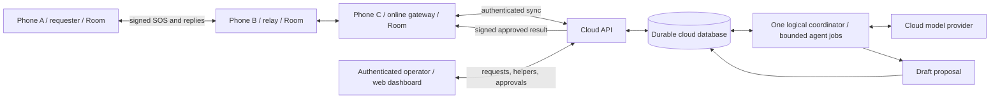

# GHOST architecture

GHOST is an Android mesh communication app for outages. The wider product includes saved-contact messaging, SOS/help and in-app internet services. **Build SOS sending first, coordinated by one cloud agent.** A web dashboard shows incoming requests, helpers/supplies and agent activity from the same cloud database. Local LLM features, ordinary chat, general information services and LoRa are later work.

Current repository state: CP01 foundations are integrated: typed contracts, deterministic Android fakes, four Android preview screens and a cloud-service health/config scaffold. SOS sending, signatures, Room, radios, database coordination and the dashboard remain planned components. See [CP01 evidence](docs/evidence/cp01/integration.md). Preserve the existing Android toolchain.

## Hackathon implementation

Keep the full SOS flow, including owner decline/replan and outage recovery. Build it
with one Android app, one server process and one PostgreSQL database. The API and
single coordinator worker live in the same service; durable jobs and worker
ownership stay in PostgreSQL. The dashboard is a static React/Vite client of that
API. These are implementation constraints, not claims that these components exist.

- Use the existing Kotlin repository/transport boundaries and simple factory
  injection. Keep new implementations concrete until another implementation needs
  a shared interface. Logical package names below do not require separate modules.
- Use Nearby only for the phone mesh. Start with bounded store-and-forward,
  deduplication and expiry; defer topology discovery and route optimization.
- Use database transactions, unique event/job keys and bounded batches for
  correctness. Poll for jobs and dashboard updates; add queues, caches, streaming
  infrastructure or more services only after measured load requires them.
- Keep model attempts short and bounded, using the existing read/draft tools and
  approval policy. Do not add an agent framework or another coordinator.
- Build one dashboard requests board with request details, offers, approval and
  actual run history. Phone Mission is a compact status summary with optional
  explanations; Network shows observed connectivity rather than a topology map.
- Preserve signed origin bytes, consent, durable queues, owner/operator authority
  and separate cloud/receipt/allocation states. Simplicity must not turn a queued
  action into a successful delivery or allocation claim.

Make small implementation changes, check the changed behavior, then move on.
Run the documented Android build/unit checks for Android changes and server
tests/build for server changes; do not repeat them without another change or
failure. Device and real-cloud observations remain separate from host checks.
Use [CHECKPOINTS.md](docs/CHECKPOINTS.md) for milestone status and
[TEST_MATRIX.md](docs/TEST_MATRIX.md) for evidence; do not create another status
ledger. The user reports CP02 in progress; its trust contract remains the baseline
for subsequent SOS work.

## SOS architecture

A connected phone can sync directly with the same cloud API. Any opted-in connected phone can be a gateway; C is the demo assignment. Gateways forward original signed events and return cloud-signed results. They do not run another coordination agent or hold provider secrets.

**No reachable internet means no cloud coordination.** Phones still create, store, relay and display SOS/resource reports; manual help remains possible. They queue cloud-authorized events until a gateway returns or the event expires. Show “Waiting for internet gateway,” not a fabricated AI response.

## One coordinator and two kinds of state

- **Room:** each phone's durable local records, outbox, received events and UI state. Save before transmitting; observe repositories through Flow.
- **Cloud database:** accepted coordination events, SOS requests, helper profiles, supply/help offers, jobs, proposals, approvals and return outbox. The agent and dashboard read the same records through the server. It knows only reports that have reached it; display freshness.
- **One logical coordinator:** one serialized agent worker for the first version, backed by durable jobs. Each job builds a bounded database snapshot; it is not one endless model conversation. Enforce exclusive worker ownership and idempotency so restarts/multiple gateways cannot create competing decisions.
- **Server policy:** validates model-selected tools and applies transactions for proposal versions and resource acceptance. The model drafts; an authenticated operator approves outgoing proposals, the resource owner accepts/declines, and the requester closes an SOS.
- After an offline owner accepts, show “Acceptance queued” until the cloud validates current availability and confirms it. Never treat a local click or an AI draft as an authoritative reservation.

## Components and ownership

Keep one Android `:app` module, a separately runnable `server/` service and a web frontend in `dashboard/`. Use Kotlin, Compose Material 3, Room, coroutines/Flow and simple factory injection on Android. Choose and record the server/database/dashboard stack, model provider and deployment target at checkpoint 1 before parallel implementation; the API/event contracts stay provider-independent. Dashboard work must not delay the SOS sending path.

CP01 role A records the selected implementation stack in
[`docs/CP01_BASELINE.md`](docs/CP01_BASELINE.md): TypeScript/Fastify server,
PostgreSQL 16, React/Vite dashboard, server-side OpenAI Responses API adapter,
and a Linux x86_64 Docker Compose deployment target. Those choices do not add
provider-specific fields to the Android or wire contracts.

| Area | Responsibility |
| --- | --- |
| Android `domain/model`, `transport/api`, shared `contracts/` | Typed events/IDs, repository and transport interfaces, protobuf/API schemas and shared fixtures |
| Android `security`, `protocol` | Stable identities, signing, verification and cloud-key pinning |
| Android `data/local`, `domain/usecase` | Room, SOS/offers, projections, transactional publication and receipts |
| Android `mesh`, `transport/nearby` | Nearby neighbor links, store-and-forward, dedup, inventory, retries and expiry |
| Android `gateway` | Opt-in authenticated cloud synchronization, durable upload/download cursors |
| Android `feature/*`, `design` | SOS, Requests/Offers, Mission Control and Network views |
| `server/api`, `server/security`, `server/data`, `server/sync` | Authenticated ingestion/read/approval API, event authorization, database and signed return delivery |
| `server/agent`, `server/tools` | Model adapter, durable single coordinator, validated read/draft tools and run trace |
| `dashboard/` | Authenticated incoming-SOS board, helper/supply directory, request details, agent trace and operator approvals; server API client only |
| Android `simulation`, server test fixtures | Fake transport/cloud/model, deterministic clock and resource data |

Paths under `server/` are logical ownership areas; checkpoint 1 maps them to the selected framework. Only the contract/integration owner edits shared schemas/interfaces and app composition/build files during team work.

## Database and dashboard

Use a durable relational cloud database, separate from each phone's Room database. Minimum records:

| Records | Stored information |
| --- | --- |
| SOS requests | Stable request ID, requester identity, category/text, optional people/coarse area, consent, current state, reported/received times and source event |
| Helpers | Verified owner NodeId, optional owner-provided display name/coarse area, help types, reported availability, consent and last update |
| Supply/help offers | Offer ID, helper/owner reference, resource or help type, quantity/unit when supplied, area, expiry, current availability and source event |
| Coordination | Proposal/version, request/offer references, allocation, agent job/tool history, operator approval and delivery evidence |

Helper profiles and offers are owner-submitted signed data, not verified rescue credentials. If an offer arrives before its profile, create an identity-only helper record; do not discard the offer or invent profile details. Enforce unique IDs, owner authorization, migrations and transactional allocation checks. Keep immutable events alongside derived records.

The dashboard initially polls bounded authenticated read APIs for incoming SOS/details and shows last-refresh/stale/error states. Requests appear only after committed cloud ingestion; an unsynchronized phone report cannot appear as received. Add the helper/supply directory and version-specific approval controls next, then actual agent traces. Dashboard users do not write database tables directly, impersonate helper owners or bypass server policy. Provider/database secrets stay off the frontend.

`MeshEngine` never calls Android radio APIs; `NearbyAdapter` never edits projection tables. Nearby supplies neighbor links, while GHOST implements multihop. `GatewayClient` syncs signed events; it is not a raw model-inference client. The model adapter and tool loop run on the server.

## End-to-end SOS flow

1. Requester writes category, description, optional people count/coarse location and sharing choices. Explicitly send after content/audience preview.
2. Sign and persist the SOS plus outbox atomically. Broadcast locally; eligible gateways upload the unchanged signed event if cloud consent permits.
3. Cloud authenticates the gateway, verifies the original signer/authority/expiry/consent, deduplicates, persists and returns a signed cloud acknowledgement. HTTP success alone is not a recipient receipt or a match.
4. Committed requests appear in the dashboard. The coordinator reads uploaded SOS/helper/offer records, selects validated tools and saves a draft. Missing/stale resources produce uncertainty or no match.
5. An authenticated human operator approves the exact proposal version in the web dashboard. Server revalidates state and writes a cloud-signed outgoing proposal to its durable outbox.
6. A gateway downloads and persists the result before relaying it to requester/offer owner. Actual phone receipt travels back through the mesh and cloud sync.
7. Owner decline triggers a new cloud job and proposal version. Owner acceptance is validated transactionally; the cloud confirms available allocation. Replacement proposals require new operator approval.

Gateway replay is expected: deduplicate by origin event ID across all gateways. Sync cursors advance only after local/server durable writes. An outage or restart must not lose pending results or duplicate consequential actions.

## Identity, privacy and trust

Use stable public-key identities independently of Nearby handles. The cloud has a configured trusted service signing identity; a gateway cannot impersonate it. Operator approval requires server authentication/role authorization, not a device's local “operator” toggle.

Separate public mesh sharing from cloud coordination consent on SOS/offers. Do not upload non-consenting records or include them in model prompts. A minimal authorized consent-revocation/update must reach the service before it can affect its already-uploaded view; do not promise instantaneous revocation across a partition.

Provider credentials and cloud signing secrets stay server-side. Keep raw SOS/location and credentials out of diagnostic logs. Signatures prove integrity, not E2E privacy: disclose relay visibility until application encryption is implemented and verified.

## Three-phone demo

A is offline and creates SOS; B is offline and relays/offers help; C has internet and bridges to the cloud. The operator opens the authenticated web dashboard on a computer or C's browser. A/C cannot connect directly. Publish test helper profiles/offers from B and C; show A's incoming SOS in the dashboard, actual cloud tool selection, approval, B's decline, cloud replanning, fresh approval and A's receipt.

Then disconnect C's internet. Prove SOS storage/relay still works and coordination shows pending. Reconnect and prove exactly one accepted event/job outcome despite retries. This is an offline-client/cloud-coordination demo, not an all-offline AI demo.

## Later local-LLM helpers

These are ideas, not checkpoint requirements or additional coordinators:

- Draft/shorten SOS text into a structured report for the user to review.
- Translate requests/replies while preserving the original wording.
- Flag missing details such as people count or an unclear landmark; suggest a clarification.
- Summarize cached, timestamped updates for the user without presenting them as live information.

Helpers cannot allocate resources, approve proposals, resolve requests or claim current cloud knowledge. Keep existing local-model setup intact but unused by this SOS phase. See [checkpoints](docs/CHECKPOINTS.md) and [team prompts](docs/BUILD_PHASES.md).
