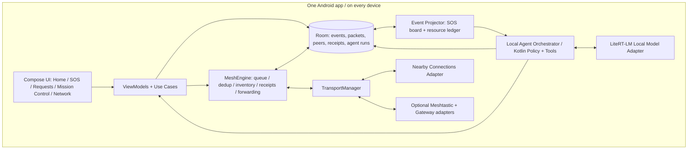

# GHOST — Locked implementation architecture v2.0

**Role:** Offline-first human-approved disaster assistance coordination with a real, limited on-device agent.  
**Scope:** 24-hour proof of capability. Not a life-safety or certified response system.

## 1. Non-negotiable decisions

1. **Single Android APK; three selectable roles.** A peer, AI coordinator and optional radio/internet bridge all share the same codebase. Only a configured coordinator runs the heavyweight language model.
2. **Single Gradle Android app for the hackathon, split by packages and narrow Kotlin interfaces.** Avoid many Gradle modules until boundaries are stable.
3. **Nearby Connections `P2P_CLUSTER` is the only required real transport.** `P2P_CLUSTER` is *not* automatic multihop: `MeshEngine` stores, de-duplicates and forwards.
4. **Local Room database is source of truth.** All writes are persisted before announcing or transmitting. All UI screens observe local `Flow` state.
5. **A single designated AI coordinator is authoritative for demo coordination proposals.** Other phones can send resource/SOS events. Do not pretend global consensus or conflict-free resource allocation.
6. **LLM runs locally on Phone C; no cloud call in core proof.** LiteRT-LM + pre-provisioned compatible `.litertlm` model. Runtime support and real tool-selection accuracy must pass a device feasibility gate.
7. **Model reasons, Kotlin executes.** The LLM returns a constrained *proposed* action as structured text; Kotlin validates it, runs an allowlisted tool, writes an audit record and requests consent for consequential actions. Never turn raw model text directly into a wireless or database command.
8. **Every SOS, resource offer, decline, acceptance and resolution is an immutable signed event.** A status view is derived from verified events; remote writes cannot silently overwrite an SOS or other sender's resource offer.
9. **Honest delivery states.** Local persistence, neighbor transmission, relay receipt, end-recipient receipt and read receipt are distinct, evidenced states.
10. **LoRa and internet gateway are optional adapters.** Both require separate proof. Neither is necessary to establish the offline Agentic AI claim.

## 2. Logical architecture



**Hardware roles for 3-phone demo:**
- **Phone A:** requester, no internet; sends SOS; receives approved response and signed recipient receipt.
- **Phone B:** relay **and volunteer X**, no internet; publishes a genuine test resource offer, later declines; remains a relay despite declining.
- **Phone C:** AI coordinator **and volunteer Y**, no internet; model finds offers, first proposes B, reads decline, then proposes local C offer for confirmation. A and C must be outside direct Nearby range.

## 3. Kotlin package structure (one `:app` module initially)

```text
app/src/main/java/org/ghost/
  app/                       Application, MainActivity, nav, DI composition
  design/                    Compose Material 3 theme, typography, components
  feature/home/              network, queue summary, quick actions
  feature/sos/               SOS composer and request details
  feature/requests/          requests board, offer composer, statuses
  feature/mission/           agent trace, proposals, approval screen
  feature/network/           peers, relay traces, permissions, diagnostics
  domain/model/              typed IDs, SOS/Offer/Event, status projections
  domain/usecase/            PublishSOS, OfferHelp, ResolveRequest, etc.
  protocol/                  frozen v1 envelope, encoder, parser, validator
  security/                  identities, signing, trust policy, consent
  data/local/                Room entities, DAO, migrations, repositories
  mesh/                      MeshEngine, queue, inventory, routing, receipts
  transport/api/             GhostTransport, PeerHandle, capabilities
  transport/nearby/          Nearby discovery, connect, send, receive
  ai/runtime/                ModelRuntime, LiteRT-LM adapter, readiness
  ai/orchestrator/           event loop, tool registry, state machine, policy
  ai/tools/                  allowlisted read/propose tools
  optional/lora/             Meshtastic adapter; behind feature flag
  optional/gateway/          whitelisted HTTP retrieval; behind flag
  simulation/                in-memory FakeTransport, deterministic clock
```

Keep UI independent of Android wireless APIs. Keep `MeshEngine` independent of the `Nearby` SDK. Keep `ai/tools/` independent of any model SDK.

## 4. Core API boundaries

```kotlin
interface GhostTransport {
    val id: String
    val events: Flow<TransportEvent>
    suspend fun start(): Result<Unit>
    suspend fun stop()
    suspend fun send(peer: PeerHandle, encoded: ByteArray): SendResult
    fun peers(): Flow<List<PeerHandle>>
}

interface MeshEngine {
    suspend fun publish(event: SignedDomainEvent): PacketId
    suspend fun onReceive(bytes: ByteArray, peer: PeerHandle, transportId: String)
    fun deliveryStates(): Flow<List<PacketDeliveryView>>
}

interface LocalModelRuntime {
    fun readiness(): Flow<ModelReadiness> // missing, loading, ready, failed
    suspend fun generateAction(prompt: String): ModelOutput
}

interface AgentTool {
    val name: String
    suspend fun execute(validated: ToolArgs): ToolResult
}
```

`NodeId` (long-lived cryptographic identity) MUST NOT equal Nearby's transient endpoint ID (`PeerHandle`). All packets enter via one validation method before Room insertion. Untrusted SOS text is **data**, never system instructions for the model.

## 5. Data model (event-oriented)

- `identities(node_id, public_key, keystore_ref, trust, created_at)`
- `peers(node_id, ephemeral_handle, trust_level, last_seen, capabilities)`
- `packet_queue(packet_id, immutable_blob, relay_blob, state, received_at, expires_at)`
- `seen_packets(packet_id, expires_at)`
- `domain_events(event_id, entity_id, event_type, signer_node_id, payload_blob, created_at, validated_at)`
- `sos_projection(request_id, owner_node_id, category, people_count, coarse_location, current_state, updated_at)`
- `offers_projection(offer_id, owner_node_id, resource_type, quantity, rough_area, offer_state, updated_at)`
- `match_proposals(proposal_id, request_id, offer_id, created_by_coordinator, state, version)`
- `agent_runs(run_id, trigger_event_id, model_id, requested_tool, tool_result_code, outcome, created_at)`
- `receipts(packet_id, recipient_node_id, receipt_type, signed_blob, received_at)`
- `relay_log(packet_id, from_peer, to_peer, transport, event, time)` (bounded retention)

Projected SOS and offer states are computed from signed immutable events. Use entity owner and event-authorized roles for transitions. Offline peers may hold **different current views**; show staleness, don't invent global truth. No autonomous resource reservation across multiple disconnected coordinators in v1.

## 6. Feature workflow

**A. SOS**: requester completes form -> consent disclosure -> sign event -> Room transaction -> queue -> Nearby -> relay B -> coordinator C -> validate -> project SOS board.

**B. Agent**: C sees new SOS/offer/decline event -> debounced deterministic trigger -> construct small redacted world state -> local model chooses from finite allowed actions -> schema parse & bounds -> Kotlin tool executes *read or proposal only* -> store trace -> approval card appears -> operator approves -> signed coordination event transmitted.

**C. Replanning**: B (volunteer X) explicitly declines -> signed DECLINED arrives C -> invalidate pending proposal -> orchestrator reruns on latest Room snapshot -> find alternative offer (e.g. volunteer Y at C) -> human confirms -> requester receives OFFERED event via B. A's signed receipt returns to C.

**D. Network disconnect**: persist first, keep pending with expiry, exchange compact IDs on recontact, transmit missing valid packets, dedup by immutable packet ID. Nearby send completion ≠ recipient delivery.

## 7. AI model feasibility gate

- Primary exploratory runtime: **Google AI Edge LiteRT-LM Kotlin** with `.litertlm` model pre-provisioned on C. Candidate small CPU/GPU model: `Qwen3-0.6B.litertlm`; compare with `gemma-4-E2B-it.litertlm` if hardware supports it. These are **candidates**, not guaranteed reliable tool-callers.
- The Android LiteRT-LM setup skill covers local text inference, **not native tool calling**. Implement function-selection as constrained structured text parsed into your own `AgentDecision`, then deterministically validate, allowlist and execute; never claim native runtime tool calling unless implemented and tested.
- Warm the model in a background dedicated single-thread owner; don't block Compose rendering or put model weights in the APK; validate model hash and space requirements. Download/transfer model ahead of offline demo.
- Hard timeouts, maximum 4 tool-action steps per run, explicit `UNAVAILABLE` when inference fails. `RulesFallback` is a **different mode** and MUST NOT be labelled “LLM agent executed”.

## 8. Security and safety

- Authenticate initial peer pairing using Nearby's displayed matching code when possible; apply per-peer rate limits, message size/TTL/hop caps, replay/dedup, and stable signed sender identities. Use maintained crypto libraries and test across actual target Android versions.
- Use the **exact immutable packet bytes** as signature input; relays only edit separately serialized relay metadata. Do not claim transport encryption equals application-wide E2E privacy.
- Public SOS metadata is visibly consent-based; allow coarse area and landmark instead of precise GPS. All agent and network trace screens should redact identifiers by default.
- A model may READ local SOS/offers and CREATE A PROPOSAL. It may **not** autonomously: commit resources, dispatch volunteers, resolve an SOS, send an outward offer, claim a rescue, or invent medical advice.
- Permission denial, no model, no peer, missing recipient receipt, stale SOS, model output invalid -> accurate user-visible state, not silent fake success.

## 9. Design priorities

Material 3 + Compose, minimal high-contrast design, explicit offline status, single prominent SOS affordance, large tap targets, accessible labels, dynamic text sizes, beautiful but sparse request cards, clear staleness labels and a visually compelling Mission Control **tool trace**. See `docs/UX_SPEC.md`.

## 10. Optional integrations

**Meshtastic/LoRa**: external Meshtastic radios needed at both bridge ends; payloads are tiny and radio region settings must be compliant. GHOST packet signatures may not fit: define and test an independently signed minimal **bridge bulletin** with source-attribution caveat; never pretend it is the untouched origin envelope. Global dedup should link bridge summary IDs to their origin event ID to avoid loops.

**Online gateway**: enabled only by an opted-in online peer; allowlist HTTPS sources, cache updates, cite publisher+age. It is not a prerequisite for local AI inference. Never send private SOS text to an internet LLM without informed authorization.

## 11. Stop/go decisions

- If the designated C handset cannot load a model and emit a validated action after the first feasibility gate, stop promising fully offline LLM inference; choose an alternate proven compatible handset/model or honestly label rules-only demo.
- If A -> B -> C true relay fails, prioritize networking over polishing optional features.
- If local inference doesn't produce consistently correct tool choices, narrow the agent's action space and verify with scripted cases; do not make the LLM an unbounded dispatcher.
- At demo freeze, turn off all external networks, keep required Bluetooth/Wi-Fi radios, and demonstrate with actual relay/agent logs.

## 12. Sources consulted

- `GHOST_System_Architecture_v1(1).md` (original team architecture proposal)
- `GHOST_Proposal_Claude_Coworkers.pdf` (approved Agentic AI proposal)
- https://developer.android.com/agents/skills/device-ai/litert/litert-lm/skill
- https://developer.android.com/topic/architecture/data-layer/offline-first
- https://developers.google.com/nearby/connections/strategies
