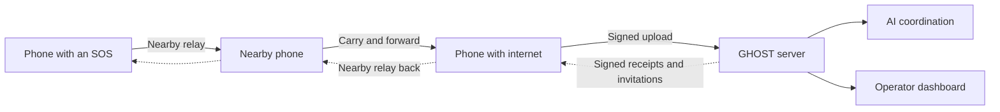

# GHOST

Video: https://www.youtube.com/watch?v=dDsuvHzaNGA

Deployed server link - https://ghost-network-9qfb.onrender.com/dashboard/

credentials:-
    username: admin
    password: pleaseletussleep

**Ask for help when the network goes quiet.**

GHOST is an Android SOS network for outages. A phone saves a request, nearby
phones carry it forward, and a phone with internet access delivers it to the
server. Cloud AI matches requests with available volunteers and supplies;
signed invitations and updates travel back through the same network.

The local relay works without internet. Cloud coordination resumes when a
gateway can reach the server.

[How it works](#how-it-works) · [Try it locally](#try-it-locally) ·
[Server setup](#run-the-server-and-dashboard) · [Project status](#project-status)

## How it works



1. **Ask.** Send an SOS with a message. Category, area, people count and GPS are optional.
2. **Relay.** Connected phones save and forward signed reports as they meet other phones, up to four transfers or expiry.
3. **Coordinate.** An online gateway uploads shared reports. The server looks for relevant volunteers and supplies.
4. **Agree.** Eligible AI suggestions invite resource owners automatically, or wait for operator approval. Owners accept or decline; the server checks availability before committing help.
5. **Follow up.** Signed updates return to participants. Requesters can confirm receipt of an arrangement, cancel an SOS or mark it resolved.

**Saved locally, received by a neighbor, received by the server and help received
are separate states.** A network connection or server receipt never means help
has arrived. Confirmation records the requester's report of receipt.

## What GHOST includes

| Component | Capabilities |
| --- | --- |
| Android app | SOS drafts and requests, optional GPS, automatic nearby connections, durable relay queues and signed receipts |
| Network view | Interactive graph of direct and recently reported links, hop filters and public display names |
| Volunteers and supplies | Publish availability, edit or withdraw offers, respond to invitations and track commitments |
| Cloud service | Authenticated device enrollment, verified uploads, durable acknowledgements and atomic resource reservations |
| AI coordinator | Separate people/transport and supply searches, alternatives after declined or expired arrangements, shared call budget |
| Operator dashboard | SOS desk and location map, helpers and supplies, AI suggestions, approval controls and request follow-up |

After **Connect to GHOST**, a foreground service keeps relay and online sync
active while the app is in the background. Disconnect stops the session;
process termination, force-stop or reboot requires another Connect tap.

## Try it locally

### Build the Android app

Use **JDK 21**, **Android SDK 36** and **Build Tools 36.0.0**. The app supports
**Android 7.0+ (API 24)**; nearby relay requires Google Play services.

Install the toolchain through Android Studio, or use the included setup scripts:

- Windows: `powershell -ExecutionPolicy Bypass -File scripts/setup-windows.ps1`
- Apple Silicon macOS: `./scripts/setup-macos.sh` (optional `--with-studio` or `--with-emulator`)

From the repository root, build and run the Android unit tests:

**Windows PowerShell**

```powershell
. .\scripts\env.ps1
.\gradlew.bat assembleDebug testDebugUnitTest
```

**macOS / Linux**

```sh
source scripts/env.sh
./gradlew assembleDebug testDebugUnitTest
```

The APK is written to `app/build/outputs/apk/debug/app-debug.apk`.
With a phone connected over ADB, use `installDebug` in place of `assembleDebug`
to install it. A server is optional for trying nearby SOS relay.

### Try a two-phone relay

1. Install GHOST on two phones with Bluetooth and Wi-Fi enabled.
2. Tap **Connect to GHOST** on each and grant the requested Android permissions. Discovery, connection and reconnection are automatic.
3. On the first phone, tap **Send SOS**, enter a message and send it.
4. Open **Requests** on the second phone. The sender records neighbor receipt only after that phone saves the report and returns a valid signed receipt.

To try carrying a message onward, let A send to B, disconnect A, then let B meet C.
C should receive A's unchanged report. Queues and saved receipts survive restarts;
missing receipts leave reports eligible for retry.

New SOS requests, volunteer publications and supply offers enable nearby sharing
and online coordination. The forms explain this audience. **Share GPS location if
available** is optional and remembered: sending tries a current fix for up to five
seconds, then a valid cached fix no older than five minutes. Missing location or
permission never blocks sending. Connecting alone does not create an SOS.

## Run the server and dashboard

Use **Node.js 22.12+** and a **PostgreSQL database** owned by the GHOST service.
Run commands from the repository root.

1. Copy [`server/.env.example`](server/.env.example) to `server/.env`.
2. Set `GHOST_DATABASE_URL` and `GHOST_CLOUD_SIGNING_KEY_PEM` to your database URL and a private P-256 PEM signing key. Literal `\n` escapes are supported in the key value. Generate your own key; fixture keys are for tests only.
3. Install dependencies and build both components:

```sh
npm --prefix server ci
npm --prefix dashboard ci
npm --prefix dashboard run build
npm --prefix server run build
```

Create an operator account; the command prompts for a hidden password of at least
15 characters. Use `--role viewer` for read-only access.

```sh
npm --prefix server run account -- --username admin --role operator
```

Start the server with the environment file loaded:

```sh
node --env-file=server/.env server/dist/index.js
```

Open **<http://127.0.0.1:3000/dashboard/>** and sign in. The server creates its
database tables on startup. `GET /v1/health` is a public health check; a healthy
process alone does not mean upload storage is configured.

For dashboard development, run `npm --prefix dashboard run dev` alongside the
server and open <http://127.0.0.1:5173/dashboard/>. Vite proxies API requests to
port 3000. Production requires HTTPS and `GHOST_DASHBOARD_ORIGIN` set to the
browser-facing origin, without `/dashboard/`.

See the [server guide](server/README.md) for authentication, configuration,
rate limits, API behavior and deployment requirements.

### Connect phones to your server

With `server/.env` configured, prepare the public Android connection settings:

```sh
node scripts/configure-client.mjs https://your-ghost-server.example
```

Rebuild and install the configured APK on participating phones. The script writes
the server URL and derived public signing key to ignored
`.local/phone-server-test/client.properties`; private keys and tokens stay out of
the APK. Release builds require HTTPS and a trusted public key.

For debug LAN testing, pass a reachable address such as `http://192.168.1.10:3000`,
bind the server to the LAN with `GHOST_HOST=0.0.0.0`, and allow the port through your
firewall. Phones must be able to reach that LAN. Reconfigure and rebuild if the
address changes.

**Connect to GHOST** starts both nearby relay and automatic online enrollment.
Phones prove possession of their Android Keystore identity and receive renewable,
encrypted gateway credentials. Hosted servers use the phone's default network;
private LAN servers use available Wi-Fi. Dashboard accounts are separate.

### Enable cloud AI coordination

AI is optional. Set these values in `server/.env` and restart the server:

```dotenv
GHOST_AI_PROVIDER=openai
OPENAI_API_KEY=<your API key>
GHOST_COORDINATOR_MODEL=<model ID available to your project>
```

For Gemini, set `GHOST_AI_PROVIDER=gemini` and `GEMINI_API_KEY` instead.
Provider credentials stay on the server; no Android rebuild is needed.

Active SOS requests and relevant availability changes trigger matching. The
dashboard shows suggestions, progress and failures. Operators can request a rerun
or enable **Require operator approval** for the whole server. Owners still have
to accept invitations before resources are reserved.

`GHOST_AI_MAX_CALLS_PER_HOUR` defaults to **120 provider calls per UTC hour**, shared
across server instances. At the limit, work waits for the next hour. This bounds
call volume, not currency spend. SOS relay and uploads work without AI settings.

### Private messages during assistance

Once an owner accepts and the server confirms the commitment, open **Message helper**
under Requests or **Message requester** under Offer help. Both phones must stay
connected to GHOST long enough to exchange their encryption keys. Text messages
then queue offline and travel through the server or supporting nearby relays.

**Waiting for delivery**, **Saved on server** and **Delivered to the other phone**
are separate states. Delivery means that phone decrypted and saved the message;
it does not mean the person read it. New messages stop when the arrangement ends
or its deadline passes. Recent encrypted history stays on the phone.

This first version supports text up to 1,000 characters, with 100 messages per
arrangement and bounded local queues. There are no attachments or chat notifications.
Deploy the updated server and update both participants and relay phones used for
chat. Older phones continue their existing SOS/coordination flow.

## Trust and privacy

- **Signed events and ownership checks.** Phone keys live in Android Keystore. Server signatures are checked against the app's trusted public key. Signatures establish key possession and integrity, not human identity.
- **Public nearby sharing.** Nearby connections have no manual pairing approval. Shared reports and coordination packets can be read and relayed by participating phones; they are not encrypted private messages. Display names are public, self-chosen labels.
- **Private chat contents.** Chat text is end-to-end encrypted with AES-GCM; a separate Android Keystore RSA key protects its per-message encryption keys. The server and relays can see participants, timing and arrangement metadata. This basic version has no forward secrecy; it does not claim protection if a participant's phone or private key is compromised.
- **Consent stays attached.** Uploads require signed sharing and cloud consent. Existing signed records retain their original audience; older local-only records stay local.
- **Limited network knowledge.** The graph shows a partial, short-lived view of reported links and connectivity. It does not prove a working route or delivery.
- **Location has an audience.** Shared GPS can appear on the authenticated dashboard. Its OpenStreetMap basemap needs internet and reveals the viewed area to the tile provider, without sending SOS text or credentials.

## Repository

| Path | Purpose |
| --- | --- |
| [`app/`](app/) | Kotlin / Jetpack Compose app, Room storage and Nearby Connections relay |
| [`server/`](server/) | TypeScript / Fastify API, PostgreSQL storage and AI worker in one service |
| [`dashboard/`](dashboard/) | React / Vite operator dashboard with a Leaflet map |
| [`contracts/ghost.proto`](contracts/ghost.proto) | Shared Protobuf wire definitions |
| [`scripts/`](scripts/) | Toolchain setup and public client configuration |
| [`PROJECT.md`](PROJECT.md) | Detailed implementation state and next work |

Server and dashboard checks:

```sh
npm --prefix server test
npm --prefix server run build
npm --prefix dashboard test
npm --prefix dashboard run build
```

Keep credentials, generated builds and local tooling out of Git. Use ignored
`.local/` or `.tmp/` for machine-specific files.

## Project status

GHOST is under active development. Nearby relay has been reported working on
physical phones, and local automated tests cover storage, signing, relay,
enrollment, coordination and assistance state changes.

Field testing remains for the complete assistance round trip, background and
lock-screen behavior, GPS acquisition, and one-tap enrollment and credential
persistence on devices. External PostgreSQL deployment and live AI provider
operation still need verification. Offline copies can remain stale until updates
arrive or expire; GHOST does not guarantee emergency delivery or assistance.

Private messaging, local AI and LoRa are future work. See
[`PROJECT.md`](PROJECT.md) for the current implementation notes.
